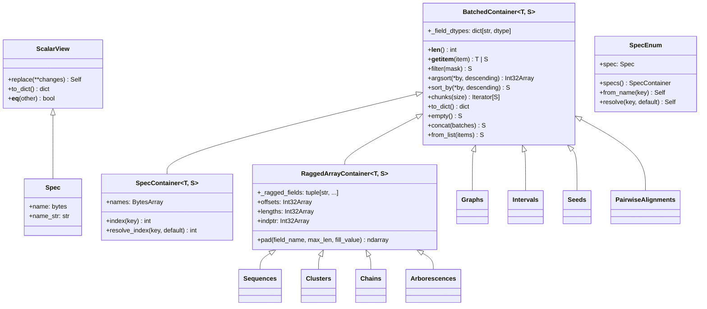

# Architecture & Core Engine

The **`seroverse`** package provides the computational foundation for the entire SeroVerse ecosystem (`SeroRef`, `KBank`, `SeroGen`, and `SeroEpi`). It is organized into two zero-overhead subpackages:

1. **[`seroverse.core`](reference/core.md)** — Zero-copy Structure-of-Arrays (SoA) container protocols (`BatchedContainer`, `RaggedArrayContainer`), genomic intervals (`Intervals`) and FASTA assemblies (`GenomeAssembly`), 2-bit DNA and `MMSEQS12` sequence engines (`Alphabet`, `Sequences`), `RandstrobeIndex` and `FracMinHashIndex` k-mer indices, banded/unbanded Smith-Waterman-Gotoh pairwise alignment (`PairwiseAligner`), hybrid motif-rescued Markov Clustering (`Clusterer`), and CSR graph data structures & solvers (`CSR`, `RelationalCSR`, `Graph`, `Graphs`, `GraphAligner`, `ArborescenceSolver`, `RelationalMPNN`, `LayoutEngine`).
2. **[`seroverse.client`](reference/client.md)** — Asynchronous, token-bucket rate-limited HTTP clients (`Client`) with `msgspec` msgpack serialization and `cassetter` replay support for querying **NCBI Entrez & Datasets** (`NCBIClient`), **ENA Portal & Browser** (`ENAClient`), **DSMZ BacDive & StrainInfo** (`BacDiveClient`, `StrainInfoClient`), and **Pathogenwatch** (`PathogenwatchClient`).

---

## 1. Zero-Copy Structure-of-Arrays (`seroverse.core.collections`)

All batched biological entities across SeroVerse implement [`BatchedContainer`][seroverse.core.collections.BatchedContainer] or [`RaggedArrayContainer`][seroverse.core.collections.RaggedArrayContainer] rather than storing Python lists of per-record objects:

- **Flat Contiguous Memory**: Variable-length sequences ([`Sequences`][seroverse.core.seq.seq.Sequences]), orthogroup clusters ([`Clusters`][seroverse.core.seq.clustering.Clusters]), and genomic intervals ([`Intervals`][seroverse.core.interval.Intervals]) pack all elements into contiguous 1D NumPy buffers indexed by `offsets` and `lengths` (`int32`).
- **$O(1)$ Contiguous Views & Parallel Gathering**: Slicing a [`RaggedArrayContainer`][seroverse.core.collections.RaggedArrayContainer] with a contiguous slice (`seqs[start:stop]`) returns a zero-copy NumPy view in $O(1)$ time; boolean masks or arbitrary index arrays dispatch to a parallel Numba gather kernel.
- **Lazy Scalar Views**: Indexing a single element (`seqs[i]` or `intervals[i]`) materializes an immutable `@dataclass(frozen=True, slots=True)` [`ScalarView`][seroverse.core.collections.ScalarView] on demand.
- **Compiled Ontology & Spec Registries ([`Spec`][seroverse.core.collections.Spec], [`SpecContainer`][seroverse.core.collections.SpecContainer], [`SpecEnum`][seroverse.core.collections.SpecEnum])**: Formalizes the declarative scalar `Spec` $\rightarrow$ read-only SoA `SpecContainer` singleton $\rightarrow$ 0-based `SpecEnum(IntEnum)` registry pattern used across downstream ontologies (`GeneRole`, `LocusArchetype`, `BacterialSpecies`, `Sugars`), providing automatic `write=False` array freezing, `Enum` field coercion, and $O(1)$ case-insensitive name/key resolution (`.specs()`, `.spec`, `.from_name()`, `.resolve()`).

---

## 2. Sequence, K-mer & Alignment Engines (`seroverse.core.seq`)

- **Bit-Packed Alphabets & Ragged Translation ([`alphabet.py`][seroverse.core.seq.alphabet])**:
  - [`Alphabet.DNA`][seroverse.core.seq.alphabet.Alphabet] encodes ASCII nucleotide strings into 2-bit integers (`0..3`) via a Numba LUT kernel and supports vectorized reverse-complementation and ragged translation across standard bacterial/viral (`table 11`), Mycoplasma (`table 4`), and candidate division (`table 25`) genetic codes ([`GeneticCode`][seroverse.core.seq.alphabet.GeneticCode]).
  - [`Alphabet.MMSEQS12`][seroverse.core.seq.alphabet.Alphabet] compresses the 20 standard amino acids into 12 physicochemical equivalence classes for high-sensitivity twilight-zone seeding.
- **Syncmer-Linked Randstrobes & FracMinHash ([`kmers.py`][seroverse.core.seq.kmers])**:
  - [`RandstrobeIndex`][seroverse.core.seq.kmers.RandstrobeIndex] links pairs of open syncmers into 64-bit strobemer hashes stored in a CSR lookup table for $O(1)$ seed matching across variable-rate indels.
  - [`FracMinHashIndex`][seroverse.core.seq.kmers.FracMinHashIndex] computes scaled bottom-hash sketches for rapid containment and Jaccard similarity estimation.
- **Vectorized Alignment, Seeds, Wavefronts & Collinear Chaining ([`score.py`][seroverse.core.align.score], [`seeds.py`][seroverse.core.align.seeds], [`pairwise.py`][seroverse.core.align.pairwise], [`chaining.py`][seroverse.core.align.chaining])**:
  - [`SubstitutionMatrix`][seroverse.core.align.score.SubstitutionMatrix] provides singleton-cached $256 \times 256$ `int8` ASCII lookup tables (`BLOSUM62`, `BLOSUM80`, `BLOSUM45`, `DNA`, and `.from_match_mismatch()`) and Karlin-Altschul ($\lambda, K$) bitscore conversions.
  - [`Seed`][seroverse.core.align.seeds.Seed] and [`Seeds`][seroverse.core.align.seeds.Seeds] unify pair-level consensus diagonal seeds and unaggregated `(q_pos, t_pos, span)` chaining anchors in a single SoA batch container.
  - [`PairwiseAligner`][seroverse.core.align.pairwise.PairwiseAligner] executes parallel `@njit(nogil=True, parallel=True)` affine-gap alignments across three engines—adaptive block-shifting Smith-Waterman-Gotoh (`mode="block"`), Affine Wavefront Alignment (`mode="wfa"`, WFA2), and static-band rolling-row Gotoh (`mode="banded"`)—alongside MMseqs2-style 4-mer CSR + ungapped diagonal prefiltering (`.prefilter()`, `.search()`), returning a [`PairwiseAlignments`][seroverse.core.align.pairwise.PairwiseAlignments] SoA batch.
  - [`Chainer`][seroverse.core.align.chaining.Chainer], [`Chains`][seroverse.core.align.chaining.Chains], and [`Chain`][seroverse.core.align.chaining.Chain] implement `minimap2`-style concave-gap collinear anchor chaining over unaggregated [`Seeds`][seroverse.core.align.seeds.Seeds] (`hits(..., aggregate=False)`), primary/secondary chain classification, and piecewise WFA2 inter-anchor gap filling + adaptive block X-drop extension.

---

## 3. Hybrid Sequence Clustering & Sparse MCL (`seroverse.core.seq.clustering`)

[`Clusterer`][seroverse.core.seq.clustering.Clusterer] groups proteins or nucleotide sequences into non-redundant orthogroups ([`Clusters`][seroverse.core.seq.clustering.Clusters] ragged SoA container with zero-copy `.as_csr()` membership matrices) through a 4-stage pipeline:

1. **Exact & Strobemer Seeding**: Deduplicates identical sequences via 64-bit `FNV-1a` hashes ([`Sequences.unique`][seroverse.core.seq.seq.Sequences.unique]), builds syncmer-linked [`RandstrobeIndex`][seroverse.core.seq.kmers.RandstrobeIndex] lookup tables, and aligns candidate pairs with banded Smith-Waterman-Gotoh ([`PairwiseAligner`][seroverse.core.align.pairwise.PairwiseAligner]).
2. **Reduced-Alphabet `MMSEQS12` Diagonal Prefilter**: In sensitive/MCL mode, builds a $12^4 = 20,736$-bucket CSR inverted index of `Alphabet.MMSEQS12` 4-mers, scores ungapped BLOSUM62 diagonals, and evaluates intra-role pairs via unbanded Smith-Waterman-Gotoh so divergent homologs are aligned even when they share zero exact k-mers.
3. **Role-Gated Motif-Embedding Rescue**: When neural motif embeddings (e.g., from `SeroRef`'s `GeneRoleClassifier`) are provided, pairs sharing the same functional role with active-site cosine similarity $\ge \tau_{\text{motif}}$ (`motif_rescue_threshold=0.75`) are rescued down to `15%` sequence identity and blended into the alignment bitscore graph.
4. **Compiled Graph Clustering Kernels**:
   - **`mode="mcl"` (Markov Cluster Algorithm)**: Runs a Numba-compiled sparse MCL solver (`_mcl_cluster`) with column-wise top-$K$ pruning, stochastic random-walk expansion, and inflation ($I = 2.0$) to resolve natural functional orthogroups.
   - **`mode="cdhit"` / `"greedy_cover"` / `"upgma"` / `"connected_components"`**: Length-descending greedy incremental clustering, greedy set cover, average-linkage UPGMA, or transitive connected components.

---

## 4. CSR Graphs, Arborescences & Relational MPNNs (`seroverse.core.graph`)

Both biosynthetic gene clusters (`SeroRef`) and chemical polysaccharide structures (`KBank`, `SeroGen`) are modeled as directed attributed graphs in [`seroverse.core.graph`](reference/core.md):

- **Bit-Packed 32-Bit Nodes, Edges & Pan-Graphs ([`models.py`][seroverse.core.graph.models])**:
  - [`IntNode`][seroverse.core.graph.models.IntNode] and [`BitField`][seroverse.core.graph.models.BitField] pack multi-attribute biological descriptors (gene roles, orthogroup IDs, monosaccharide stereochemistry, linkage positions) into primitive `uint32` integers.
  - [`Graph`][seroverse.core.graph.models.Graph] and [`Graphs`][seroverse.core.graph.models.Graphs] store thousands of variable-size graphs in flat contiguous SoA arrays with parallel Numba slicing, Laplacian spectral Wasserstein-1 distances, and **`.as_pan_graph()`** to compress a batch of graphs into a unified directed consensus network.
- **Weisfeiler-Lehman + Hungarian Bipartite Graph Alignment ([`align.py`][seroverse.core.graph.align])**:
  - [`GraphAligner`][seroverse.core.graph.align.GraphAligner] combines pluggable semantic node/edge cost strategies with continuous Weisfeiler-Lehman neighborhood smoothing ([`WeisfeilerLehmanEmbedding`][seroverse.core.graph.align.WeisfeilerLehmanEmbedding]) and Hungarian minimum-cost assignment.
- **Sparse CSR & Multi-Relational CSR Matrices ([`csr.py`][seroverse.core.graph.csr])**:
  - [`CSR`][seroverse.core.graph.csr.CSR] provides a lightweight, Numba-accelerated Compressed Sparse Row matrix with SpMV/SpMM (`@`), transpose (`.T`), degree reductions (`.sum()`), Laplacian construction (`.laplacian()`), Union-Find connected components (`.connected_components()`), and submatrix slicing.
  - [`RelationalCSR`][seroverse.core.graph.csr.RelationalCSR] subclasses [`CSR`][seroverse.core.graph.csr.CSR] to represent multi-relational incoming-edge graphs with per-relation degree normalization and virtual global pool vertices (`.from_edges()`, `.from_multihop()`, `.from_graph()`, `.from_batch()`).
- **Directed Spanning Arborescences & Constrained $K$-Best Enumeration ([`arborescence.py`][seroverse.core.graph.arborescence])**:
  - [`ArborescenceSolver`][seroverse.core.graph.arborescence.ArborescenceSolver], [`Arborescence`][seroverse.core.graph.arborescence.Arborescence], and [`Arborescences`][seroverse.core.graph.arborescence.Arborescences] combine an $O(N^2)$ Chu-Liu/Edmonds optimum branching solver with a compiled Numba branch-and-bound solver supporting 3D `(N, N, S)` valence/slot exclusivity (`slot_exclusivity=True`) and `edge_groups` constraints.
- **Numba Relational Message-Passing Neural Network ([`gnn.py`][seroverse.core.graph.gnn])**:
  - [`RelationalMPNN`][seroverse.core.graph.gnn.RelationalMPNN] executes parallel `@njit` forward and backward relational message passing over multi-hop incoming-edge CSR graphs ([`RelationalCSR`][seroverse.core.graph.csr.RelationalCSR]) with RMSNorm, clamped-node anchor injection, and bilinear multi-channel edge/slot scoring.
- **Force-Directed & Spectral Coordinate Layouts ([`layout.py`][seroverse.core.graph.layout])**:
  - [`LayoutEngine`][seroverse.core.graph.layout.LayoutEngine] computes 2D/3D Fruchterman-Reingold and spectral coordinates for interactive visualization of pan-locus networks and chemical graphs.

---

## 5. Async Biological Repository Clients (`seroverse.client`)

[`seroverse.client`](reference/client.md) provides a unified, rate-limited asynchronous HTTP client layer built on `aiohttp` and `msgspec`:

- **Token-Bucket Rate Limiting & Msgpack Cassettes ([`base.py`][seroverse.client.base])**:
  - [`Client`][seroverse.client.base.Client] enforces per-endpoint concurrency semaphores, polite request pacing, and deterministic offline replay via `cassetter` and `msgspec` msgpack serialization ([`encode_msgpack`][seroverse.client.base.Client.encode_msgpack], [`decode_msgpack`][seroverse.client.base.Client.decode_msgpack]).
- **Repository-Specific Clients**:
  - **[`NCBIClient`][seroverse.client.ncbi.NCBIClient] (`seroverse.client.ncbi`)**: Async wrapper for NCBI Entrez E-utilities (`esearch`, `esummary`, `efetch`, `elink`) and NCBI Datasets v2 REST API (`DatasetAssemblyReport`, `NuccoreSummary`, `PubMedSummary`).
  - **[`ENAClient`][seroverse.client.ena.ENAClient] (`seroverse.client.ena`)**: Queries the ENA Portal API, Browser FASTA/embl endpoints, and NCTC reference strain metadata (`ENAAssemblyRecord`, `ENASampleRecord`, `NCTCReferenceStrain`).
  - **[`BacDiveClient`][seroverse.client.dsmz.BacDiveClient] & [`StrainInfoClient`][seroverse.client.dsmz.StrainInfoClient] (`seroverse.client.dsmz`)**: Resolves culture collection synonym rings, serovar metadata, and linked literature across DSMZ BacDive and StrainInfo (`StrainPassport`, `StrainLiterature`).
  - **[`PathogenwatchClient`][seroverse.client.pathogenwatch.PathogenwatchClient] (`seroverse.client.pathogenwatch`)**: Streams curated global surveillance collections, assembly accessions, and antimicrobial resistance / serotype metadata (`PathogenwatchCollection`, `PathogenwatchCollectionBundle`).
