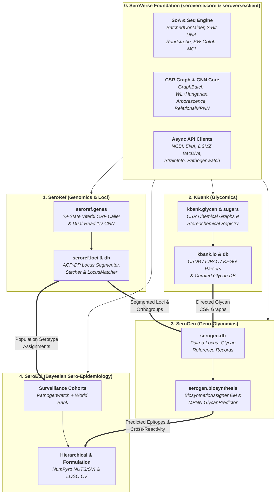

<div class="sv-hero" markdown>

# From Genome Assemblies to Glycan Structures & Vaccine Formulations

**SeroVerse** is an end-to-end, high-performance Python ecosystem powered by a shared zero-copy Structure-of-Arrays (SoA) core (**`seroverse`**) uniting **bacterial polysaccharide locus genomics (`SeroRef`)**, **chemical glycan databases (`KBank`)**, **geno-glycomic biosynthetic pathway alignment & structure prediction (`SeroGen`)**, and **hierarchical Bayesian sero-epidemiological modelling (`SeroEpi`)**.

<div class="sv-badges">
  
  
  
  
  
</div>

<div class="sv-hero-actions" markdown>
  <a href="#the-four-pillars" class="sv-btn sv-btn--primary" markdown="span">:lucide-layers: Explore the Ecosystem</a>
  <a href="reference/" class="sv-btn sv-btn--secondary" markdown="span">:lucide-code-xml: Core &amp; Client API</a>
  <a href="https://github.com/SeroVerse" target="_blank" rel="noopener" class="sv-btn sv-btn--secondary" markdown="span">:fontawesome-brands-github: GitHub Organization ↗</a>
</div>

<div class="sv-stat-strip">
  <div class="sv-stat-item">
    <span class="sv-stat-value">&gt;65 Mb/s</span>
    <span class="sv-stat-label">Single-pass bacterial + prophage ORF calling (~70 ms per genome)</span>
  </div>
  <div class="sv-stat-item">
    <span class="sv-stat-value">1,530</span>
    <span class="sv-stat-label">Curated bacterial glycan graphs paired with biosynthetic gene clusters</span>
  </div>
  <div class="sv-stat-item">
    <span class="sv-stat-value">91.4% F1</span>
    <span class="sv-stat-label">Zero-dependency 1D-CNN protein role classification across 30 roles</span>
  </div>
  <div class="sv-stat-item">
    <span class="sv-stat-value">MCMC &amp; SVI</span>
    <span class="sv-stat-label">Hierarchical Bayesian prevalence &amp; LOSO-validated vaccine design</span>
  </div>
</div>

</div>

---

## The Four Pillars { #the-four-pillars }

Built atop **[`seroverse.core`](reference/core.md)** and **[`seroverse.client`](reference/client.md)**, the SeroVerse ecosystem is organized into four specialized pillar packages. Select a pillar below to explore its documentation, interactive benchmark slide decks, API references, and live applications.

<div class="sv-pillar-grid">

  <article class="sv-pillar-card sv-pillar-card--seroref">
    <div>
      <div class="sv-pillar-header">
        <h3 class="sv-pillar-title">
          <svg xmlns="http://www.w3.org/2000/svg" fill="none" stroke="currentColor" stroke-linecap="round" stroke-linejoin="round" stroke-width="2" class="lucide lucide-dna" viewBox="0 0 24 24" aria-hidden="true"><path d="m10 16 1.5 1.5M14 8l-1.5-1.5M15 2c-1.798 1.998-2.518 3.995-2.807 5.993M16.5 10.5l1 1M17 6l-2.891-2.891M2 15c6.667-6 13.333 0 20-6M20 9l.891.891M3.109 14.109 4 15M6.5 12.5l1 1M7 18l2.891 2.891M9 22c1.798-1.998 2.518-3.995 2.807-5.993"/></svg>
          <span>SeroRef</span>
        </h3>
        <span class="sv-pillar-badge">1 · Genomics &amp; Loci</span>
      </div>
      <p class="sv-pillar-desc">
        Genomic ORF caller, dual-head 1D-CNN protein role &amp; prophage classifier (<code>seroref.genes</code>), exact ACP-DP capsule/O-antigen locus segmenter, contig-split stitcher, and reference locus database matcher (<code>seroref.loci</code>, <code>seroref.db</code>).
      </p>
      <div class="sv-pillar-metrics">
        <span class="sv-metric-pill">Zero CLI Dependencies</span>
        <span class="sv-metric-pill">99.7% 3'-Stop Recall</span>
        <span class="sv-metric-pill">100% Contig-Split Stitching</span>
      </div>
    </div>
    <div class="sv-pillar-links">
      <a href="https://seroverse.github.io/SeroRef/" class="sv-pillar-link">Docs &amp; Guide</a>
      <a href="https://seroverse.github.io/SeroRef/reference/" class="sv-pillar-link sv-pillar-link--ghost">API</a>
      <a href="https://github.com/SeroVerse/SeroRef" target="_blank" rel="noopener" class="sv-pillar-link sv-pillar-link--ghost">GitHub ↗</a>
    </div>
  </article>

  <article class="sv-pillar-card sv-pillar-card--kbank">
    <div>
      <div class="sv-pillar-header">
        <h3 class="sv-pillar-title">
          <svg xmlns="http://www.w3.org/2000/svg" fill="none" stroke="currentColor" stroke-linecap="round" stroke-linejoin="round" stroke-width="2" class="lucide lucide-hexagon" viewBox="0 0 24 24" aria-hidden="true"><path d="M21 16V8a2 2 0 0 0-1-1.73l-7-4a2 2 0 0 0-2 0l-7 4A2 2 0 0 0 3 8v8a2 2 0 0 0 1 1.73l7 4a2 2 0 0 0 2 0l7-4A2 2 0 0 0 21 16"/></svg>
          <span>KBank</span>
        </h3>
        <span class="sv-pillar-badge">2 · Glycomics &amp; Chemistry</span>
      </div>
      <p class="sv-pillar-desc">
        Curated bacterial surface polysaccharide database (<code>kbank.db</code>), stereochemical monosaccharide &amp; substituent ontology (<code>kbank.sugars</code>), and zero-copy CSR chemical graph engine with <code>CSDB</code>, <code>IUPAC</code>, and <code>KEGG KCF</code> parsers (<code>kbank.glycan</code>, <code>kbank.io</code>).
      </p>
      <div class="sv-pillar-metrics">
        <span class="sv-metric-pill">CSDB / IUPAC / KEGG</span>
        <span class="sv-metric-pill">CSR Chemical Graphs</span>
        <span class="sv-metric-pill">SNFG Glycan Rendering</span>
      </div>
    </div>
    <div class="sv-pillar-links">
      <a href="https://seroverse.github.io/KBank/" class="sv-pillar-link">Docs &amp; Guide</a>
      <a href="https://seroverse.github.io/KBank/notebooks/" class="sv-pillar-link sv-pillar-link--ghost">Benchmarks</a>
      <a href="https://seroverse.github.io/KBank/reference/" class="sv-pillar-link sv-pillar-link--ghost">API</a>
      <a href="https://github.com/SeroVerse/KBank" target="_blank" rel="noopener" class="sv-pillar-link sv-pillar-link--ghost">GitHub ↗</a>
    </div>
  </article>

  <article class="sv-pillar-card sv-pillar-card--serogen">
    <div>
      <div class="sv-pillar-header">
        <h3 class="sv-pillar-title">
          <svg xmlns="http://www.w3.org/2000/svg" fill="none" stroke="currentColor" stroke-linecap="round" stroke-linejoin="round" stroke-width="2" class="lucide lucide-waypoints" viewBox="0 0 24 24" aria-hidden="true"><circle cx="12" cy="4.5" r="2.5"/><path d="m10.2 6.3-3.9 3.9"/><circle cx="4.5" cy="12" r="2.5"/><path d="M7 12h10"/><circle cx="19.5" cy="12" r="2.5"/><path d="m13.8 17.7 3.9-3.9"/><circle cx="12" cy="19.5" r="2.5"/></svg>
          <span>SeroGen</span>
        </h3>
        <span class="sv-pillar-badge">3 · Geno-Glycomics</span>
      </div>
      <p class="sv-pillar-desc">
        Geno-glycomic integration engine bridging <code>SeroRef</code> biosynthetic gene clusters and <code>KBank</code> chemical structures (<code>serogen.db</code>) via pan-graph Expectation-Maximization enzyme-to-linkage alignment, 10-head cluster classifiers, and Relational MPNN <em>de novo</em> structure prediction (<code>serogen.biosynthesis</code>).
      </p>
      <div class="sv-pillar-metrics">
        <span class="sv-metric-pill">1,530 Locus–Glycan Pairs</span>
        <span class="sv-metric-pill">&gt;92% Monosaccharide F1</span>
        <span class="sv-metric-pill">Bipartite GT-Linkage EM</span>
      </div>
    </div>
    <div class="sv-pillar-links">
      <a href="https://seroverse.github.io/SeroGen/" class="sv-pillar-link">Docs &amp; Guide</a>
      <a href="https://seroverse.github.io/SeroGen/notebooks/" class="sv-pillar-link sv-pillar-link--ghost">Marimo Slides</a>
      <a href="https://seroverse.github.io/SeroGen/reference/" class="sv-pillar-link sv-pillar-link--ghost">API</a>
      <a href="https://github.com/SeroVerse/SeroGen" target="_blank" rel="noopener" class="sv-pillar-link sv-pillar-link--ghost">GitHub ↗</a>
    </div>
  </article>

  <article class="sv-pillar-card sv-pillar-card--seroepi">
    <div>
      <div class="sv-pillar-header">
        <h3 class="sv-pillar-title">
          <svg xmlns="http://www.w3.org/2000/svg" fill="none" stroke="currentColor" stroke-linecap="round" stroke-linejoin="round" stroke-width="2" class="lucide lucide-chart-network" viewBox="0 0 24 24" aria-hidden="true"><path d="m13.11 7.664 1.78 2.672M14.162 12.788l-3.324 1.424M20 4l-6.06 1.515M3 3v16a2 2 0 0 0 2 2h16"/><circle cx="12" cy="6" r="2"/><circle cx="16" cy="12" r="2"/><circle cx="9" cy="15" r="2"/></svg>
          <span>SeroEpi</span>
        </h3>
        <span class="sv-pillar-badge">4 · Epidemiology</span>
      </div>
      <p class="sv-pillar-desc">
        <code>scikit-learn</code> and <code>JAX</code>/<code>NumPyro</code> library for genomic sero-epidemiology. Ingests Pathogenwatch cohorts and UN/World Bank demographics, fits stratified hierarchical Bayesian prevalence models, and optimizes multi-valent vaccine and phage formulations.
      </p>
      <div class="sv-pillar-metrics">
        <span class="sv-metric-pill">NUTS MCMC &amp; SVI</span>
        <span class="sv-metric-pill">LOSO Formulation CV</span>
        <span class="sv-metric-pill">PyShiny Web Dashboard</span>
      </div>
    </div>
    <div class="sv-pillar-links">
      <a href="https://seroverse.github.io/SeroEpi/" class="sv-pillar-link">Docs &amp; Guide</a>
      <a href="https://tomdstanton-seroepi.share.connect.posit.cloud" target="_blank" rel="noopener" class="sv-pillar-link sv-pillar-link--ghost">Live Web App ↗</a>
      <a href="https://seroverse.github.io/SeroEpi/app/" class="sv-pillar-link sv-pillar-link--ghost">Embedded App</a>
      <a href="https://github.com/SeroVerse/SeroEpi" target="_blank" rel="noopener" class="sv-pillar-link sv-pillar-link--ghost">GitHub ↗</a>
    </div>
  </article>

</div>

---

## End-to-End Ecosystem Architecture

At the foundation, **`seroverse`** provides the shared Structure-of-Arrays (SoA) memory containers, SIMD sequence/clustering kernels, CSR graph solvers, and rate-limited biological repository clients consumed across all four pillars:



---

## Technical Highlights Across the Suite

<div class="grid cards" markdown>

-   :lucide-orbit: **Zero-Copy SoA Core & Async Clients (`SeroVerse`)**

    ---

    Contigs, intervals, sequences, k-mer randstrobes, and CSR graphs live in contiguous NumPy Structure-of-Arrays buffers ([`seroverse.core`](reference/core.md)) paired with async token-bucket rate-limited clients ([`seroverse.client`](reference/client.md)) for NCBI, ENA, DSMZ BacDive/StrainInfo, and Pathogenwatch.

-   :lucide-dna: **Single-Pass ORF Calling & ACP-DP Loci (`SeroRef`)**

    ---

    `OrfPredictor` decodes bacterial and prophage genes at **>65 Mb/s** (**99.7% 3'-stop recall**), `GeneRoleClassifier` assigns 29 biosynthetic roles + bacteriophage origin via a pure Numba 1D-CNN, and `LocusPredictor` segments and stitches capsule/O-antigen loci across contigs.

-   :lucide-hexagon: **CSR Chemical Glycan Graphs (`KBank`)**

    ---

    `KBank` parses `CSDB`, `IUPAC`, and `KEGG KCF` representations into bit-packed CSR chemical graphs (`Glycan`, `GlycanBatch`) backed by a complete stereochemical monosaccharide and substituent registry (`kbank.sugars`).

-   :lucide-waypoints: **Geno-Glycomic Alignment & MPNN Prediction (`SeroGen`)**

    ---

    `BiosyntheticAssigner` maps glycosyltransferases, acetyltransferases, and `Wzy` polymerases onto specific monosaccharide linkages via pan-graph EM, while `GlycanPredictor` reconstructs complete repeating-unit topologies *de novo* via a Relational MPNN and constrained spanning arborescence solver.

-   :lucide-chart-bar-stacked: **Hierarchical Partial Pooling (`SeroEpi`)**

    ---

    `SeroEpi` models geographic, temporal, and clinical sampling heterogeneity using `JAX`/`NumPyro` Binomial and Beta-Binomial hierarchical estimators (`MCMC` NUTS and `SVI`), preventing small-stratum noise from distorting global antigen rankings.

-   :lucide-shield-check: **LOSO-Validated Vaccine Formulation (`SeroEpi`)**

    ---

    The `Formulation` meta-estimator selects optimal $K$-valent capsule/O-antigen cocktails under pooled or equal-stratum weights, controls Bayesian/BH False Discovery Rates against burden thresholds, and quantifies geographic generalizability via Leave-One-Stratum-Out CV.

</div>

---

## Unified Quickstart

=== "0. SeroVerse — Core SoA & Repository Clients"

    ```python
    from seroverse.client.ncbi import NCBIClient
    from seroverse.core.io.fasta import GenomeAssembly
    from seroverse.core.seq.clustering import Clusterer

    # 1. Load a multi-contig FASTA assembly into a zero-copy 2-bit DNA SoA container
    assembly = GenomeAssembly.from_fasta("klebsiella_isolate.fasta")
    print(f"Loaded {len(assembly)} contigs ({assembly.total_length:,} bp)")

    # 2. Cluster protein sequences using SIMD Smith-Waterman-Gotoh + sparse Markov Clustering (MCL)
    clusterer = Clusterer(mode="mcl", min_identity=0.30)

    # 3. Query NCBI Entrez / Datasets asynchronously with token-bucket rate limiting
    async with NCBIClient() as ncbi:
        summaries = await ncbi.fetch_nuccore_summaries(["CP014225.1"])
    ```

=== "1. SeroRef — De Novo Locus & Serotype Calling"

    ```python
    from seroref.loci.matcher import LocusMatcher
    from seroref.loci.models import LocusDatabase
    from seroref.loci.predictor import LocusPredictor
    from seroverse.core.io.fasta import GenomeAssembly

    # 1. Load a bacterial genome assembly (single or fragmented multi-contig FASTA)
    assembly = GenomeAssembly.from_fasta("klebsiella_isolate.fasta")

    # 2. Predict ORFs (bacterial + prophage), classify 29 CNN gene roles, and segment loci via ACP-DP
    predictor = LocusPredictor()
    loci = predictor.predict(assembly)

    for locus in loci:
        print(f"{locus.archetype.name}: {locus.start}..{locus.end} ({len(locus.genes)} genes)")

    # 3. Match segmented loci against a compiled reference database with bipartite synteny alignment
    db = LocusDatabase.load("spneumo_cps.npz")
    matcher = LocusMatcher.from_database(db)
    best = matcher.match(loci)[0]
    print(f"Serotype: {best.serotype} (score={best.score:.3f}, AA identity={best.mean_aa_identity:.1%})")
    ```

=== "2. KBank & 3. SeroGen — Glycan Graphs & De Novo Biosynthesis"

    ```python
    from kbank.glycan import Glycan
    from serogen.biosynthesis.align import BiosyntheticAssigner
    from serogen.biosynthesis.predictor import GlycanPredictor
    from serogen.db.records import SeroGenRecords
    from seroref.loci.predictor import LocusPredictor
    from seroverse.core.io.fasta import GenomeAssembly

    # 1. Parse a linear CSDB/IUPAC polysaccharide structure into a directed CSR chemical graph
    glycan = Glycan.from_csdb("-3)[aDGlcp(1-2)]bDGalp(1-")

    # 2. Segment a capsular polysaccharide locus from raw assembly DNA via SeroRef
    assembly = GenomeAssembly.from_fasta("KL106.fasta")
    locus = LocusPredictor().predict(assembly)[0]

    # 3. Predict the repeating-unit structure de novo or align enzymes to linkages via SeroGen
    records = SeroGenRecords.load()
    predictor = GlycanPredictor.from_records(records)
    top_hit = predictor.predict(locus, top_k=1)[0]
    assigner = BiosyntheticAssigner()
    assignment = assigner.assign_record(top_hit.glycan, locus)
    ```

=== "4. SeroEpi — Bayesian Prevalence & Vaccine Design"

    ```python
    from seroepi.aggregate import Aggregator
    from seroepi.estimators.formulation import FormulationEstimator
    from seroepi.estimators.hierarchical import HierarchicalSVIEstimator
    from seroepi.examples import KlebnetNeonatalSepsis
    from seroepi.plotting.choropleth import ChoroplethPlotter

    # 1. Load the KlebNET Neonatal Sepsis surveillance cohort (981 K. pneumoniae isolates)
    ds = KlebnetNeonatalSepsis.load_built()

    # 2. Aggregate K-locus serotype counts stratified by country/site
    agg = Aggregator(target=ds.var("K_locus"), strata=[ds.var("country")]).fit(ds)

    # 3. Fit a NumPyro Hierarchical Bayesian estimator & 10-valent vaccine formulation
    est = HierarchicalSVIEstimator().fit(agg)
    vaccine = FormulationEstimator(max_valency=10).fit(est)
    chart = ChoroplethPlotter().plot(est)
    ```

---

## Interactive Benchmarks & Live Applications

| Pillar | Interactive Resource | Highlights |
| :--- | :--- | :--- |
| **SeroRef / SeroGen** | [Prophage & Bacterial ORF Benchmark](https://seroverse.github.io/SeroGen/notebooks/prophage-orfs/) | Interactive 16:9 Marimo slide deck benchmarking `OrfPredictor` across complete bacterial chromosomes (**99.7% 3'-stop recall**) and prophages (**95.3% recall**). |
| **SeroRef / SeroGen** | [Multi-Scale 1D-CNN Role Classifier](https://seroverse.github.io/SeroGen/notebooks/gene-classifier/) | Optuna TPE hyperparameter tuning and layer sweep across 29 polysaccharide biosynthesis, transport, and MGE roles + phage origin head. |
| **SeroRef / SeroGen** | [*S. pneumoniae* De Novo CPS Database](https://seroverse.github.io/SeroGen/notebooks/spneumo-serotyping/) | Whole-genome de novo locus segmentation, hybrid MCL clustering, pan-locus graph construction, and contig-split boundary stitching. |
| **KBank / SeroGen** | [Glycan Curation, 10-Head CNNs & MPNN Predictor](https://seroverse.github.io/KBank/notebooks/) | Curation of **1,530** bacterial surface polysaccharide structures, pan-graph EM glycosyltransferase assignment, and Relational MPNN *de novo* structure recovery. |
| **SeroEpi** | [Live PyShiny Surveillance & Formulation App ↗](https://tomdstanton-seroepi.share.connect.posit.cloud) | Interactive cohort explorer, compositional antigen target builder, NUTS MCMC / SVI Bayesian prevalence fitting, spatial choropleths, UpSet plots, and vaccine coverage curves. |

---

## Installation

Install the core `seroverse` package or any of the pillar packages via [`uv`](https://docs.astral.sh/uv/) or `pip`:

```bash
# 0. Core SoA containers, SIMD sequence/graph algorithms, and async API clients
uv add "seroverse[all]"

# 1. Genomic ORF calling, 1D-CNN role classification, and de novo locus segmentation
uv add seroref

# 2. Bacterial surface glycan database and CSDB/IUPAC/KEGG chemical graph engine
uv add kbank

# 3. Geno-glycomic enzyme-to-linkage alignment and MPNN structure prediction
uv add serogen

# 4. Bayesian sero-epidemiological estimators, plotting, and interactive PyShiny dashboard
uv add "seroepi[all]"
```
